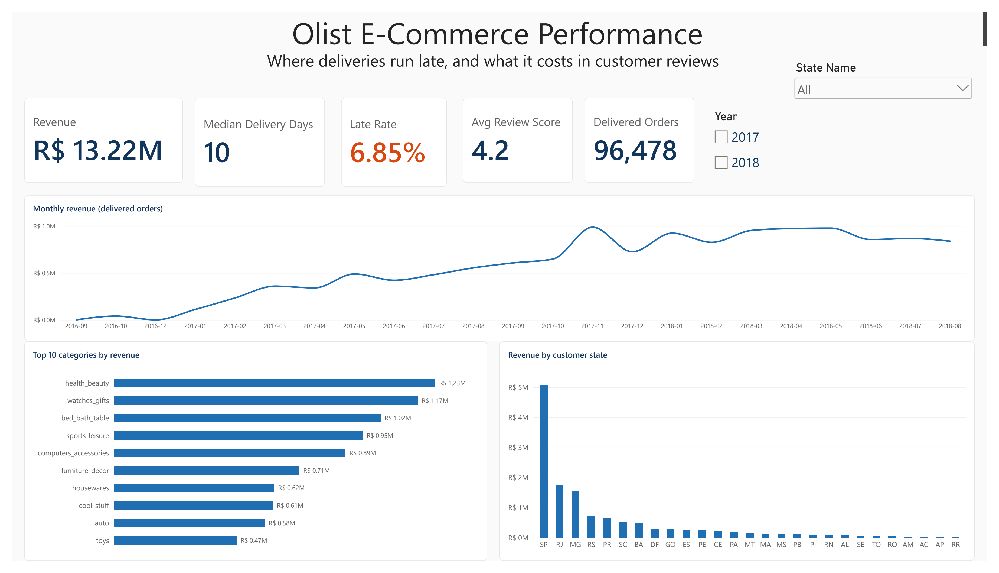
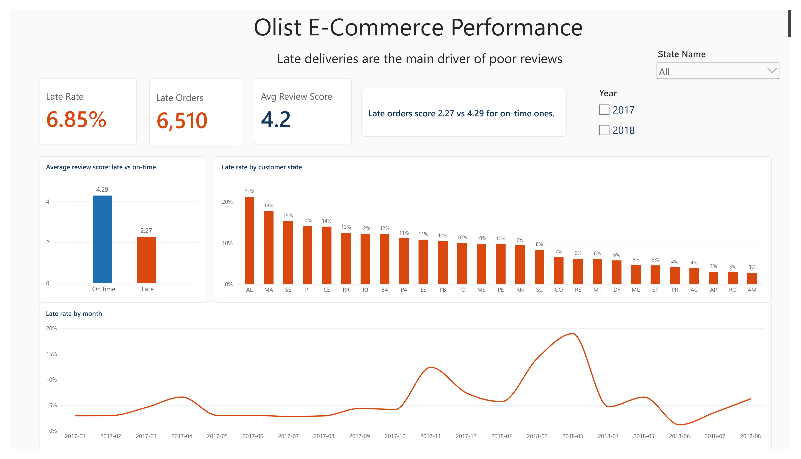
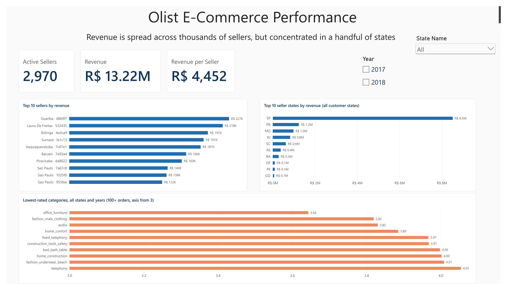

# Olist E-Commerce Performance: Late Deliveries and Customer Reviews

An end-to-end analytics project on the public Olist Brazilian E-Commerce dataset: cleaned in pandas, loaded into SQL Server, analysed with SQL and presented in a three-page Power BI dashboard.

**The question:** where do deliveries run late, and what does it cost in customer reviews?

**The short answer:** about 6.85% of delivered orders arrive after the promised date, and those customers rate the experience about two points lower (2.27 against 4.29 on a five-point scale).

### Executive Overview

### Delivery & Reviews

### Sellers & Products

---

## Tools

| Stage | Tool |
|---|---|
| Cleaning | Python, pandas (VS Code notebooks, one per table) |
| Loading | SQLAlchemy + pyodbc into SQL Server Express (`OlistEcommerce`) |
| Analysis | SQL (joins, CTEs, aggregates, `PERCENTILE_CONT`) |
| Visualisation | Power BI Desktop (Import mode, DAX measures, synced slicers) |

---

## Data

Eight tables from the Olist public dataset, cleaned and loaded with primary and foreign keys enforced. After loading, row counts and payment/price sums were reconciled back to the cleaned files.

| Table | Rows after cleaning |
|---|---|
| customers | 99,441 |
| orders | 99,441 |
| order_items | 112,650 |
| order_payments | 103,886 |
| order_reviews | 99,224 |
| products | 32,951 |
| sellers | 3,095 |
| geolocation | 19,015 (one row per zip prefix; raw file had 1,000,163 rows) |

Each table has its own cleaning notes (README and script) describing every decision.

### Cleaning principles
- **Nothing invented.** Where a value could not be derived from the data, it was left empty or marked `Unknown`, and the row was flagged.
- **Zip codes are stored as text, 5 characters**, so leading zeros are never lost.
- **Exact duplicates were dropped only where the rows carry no information.** The geolocation table was reshaped to one row per zip (median coordinates, excluding points outside Brazil), because joining the raw table would multiply every customer and seller row.
- **Problems are flagged, not hidden:** for example `has_data_issue` on orders and `city_was_fixed` on sellers.

---

## Metric definitions

| Metric | Definition |
|---|---|
| Revenue | Sum of item `price` on delivered orders (BRL, excludes freight) |
| Delivered orders | Distinct orders with status `delivered` |
| Late order | Delivered after the estimated delivery date |
| Late rate | Late orders / clean delivered orders (delivered, no data issue, delivery time present) |
| Median delivery days | Median days from purchase to delivery, delivered orders without data issues |
| Avg review score | Latest review per order, delivered orders without data issues |
| Active sellers | Distinct sellers with at least one delivered order |

"Late" is measured against the promised date, not against speed. A slow region can still have a low late rate if the promise was generous.

---

## Key findings

1. **Late deliveries hurt reviews.** Late orders average 2.27 against 4.29 for on-time ones, a gap of about two points.
2. **Lateness varies much more by customer state than by seller state.** The late rate by customer state runs from about 21% (AL) down to about 3%.
3. **Lateness is worse in 2018.** 2017 late rate 5.65%, 2018 late rate 7.88% (January to August only). Late rate peaks around November 2017 and March 2018.
4. **Revenue is concentrated geographically but spread across sellers.** São Paulo sellers account for about 64% of revenue and the top 10 seller states for about 99%. The top 10 sellers together earn about 13% of revenue, so no single seller dominates.
5. **Product category matters far less than delivery.** The lowest-rated categories (office_furniture 3.64, fashion_male_clothing 3.82, audio 3.83) are still well above the 2.27 of late orders.
6. **Headline numbers:** R$13.22M revenue, 96,478 delivered orders, median delivery 10 days, average review 4.2, 2,970 active sellers (R$4,452 revenue per seller).

---

## Dashboard

| Page | Purpose |
|---|---|
| Executive Overview | Revenue, median delivery days, late rate, review score, monthly revenue, top categories, revenue by customer state |
| Delivery & Reviews | Late rate and late orders, review score late vs on-time, late rate by customer state and by month |
| Sellers & Products | Active sellers, top 10 sellers, top 10 seller states, lowest-rated categories |

Design choices:
- **Colour carries meaning.** Blue is normal, orange is anything about lateness, and a softer orange marks poorly rated categories.
- **Slicers (Year, State) are synced across pages.** Charts that rank states, and the lowest-rated categories chart, deliberately ignore the slicers, so the rankings stay readable.
- **2016 is hidden from the Year slicer** because it has very few orders (September to December). Its data is still in the totals.

---

## Limitations and judgement calls

- **Partial years.** 2016 covers September to December and 2018 covers January to August, so year-on-year comparisons are indicative.
- **Correlation, not causation.** Late orders score lower, but the data cannot prove lateness is the only reason.
- **No cost or profit data.** Revenue is item price only; there is no margin analysis.
- **Small samples.** Single states in single years can have very few orders; the lowest-rated categories chart requires at least 100 delivered orders per category.
- **Review score card** counts delivered orders without data issues, consistent with the late metrics.
- **Geolocation** is a zip-level centre (not street-level); 4 zips have no coordinates.
- **Manual choices to review:** `sbc` mapped to São Bernardo do Campo for two sellers; the district "Pirituba" kept as the city for one seller; two product category translations added by hand.

---

## How to reproduce

1. Download the dataset from Kaggle (Olist Brazilian E-Commerce Public Dataset) into `raw/`.
2. Run the notebooks `01_orders` to `08_geolocation` in order (each writes a file to `cleaned/`).
3. Run `09_load_to_sql.ipynb` to create tables and keys in SQL Server.
4. Open `olist_dashboard.pbix` and refresh.

---

*Built by Olakunle Ogunleye.*
